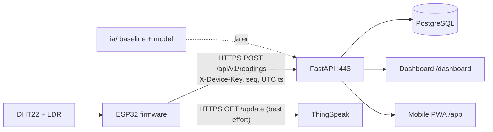

# IoT Environment Monitor

An ESP32 board reads temperature, humidity and light, sends every reading to a cloud API over HTTPS, and
people follow it on a web dashboard and a mobile app (PWA). The system keeps working when Wi-Fi drops,
a sensor fails or the server restarts: readings are buffered on the board and resent in order, and a duplicate
message never creates a second row.

> Status: **v0.9-previa** (technical preview). See `REQUISITOS_UC.md` for what is done, partial and pending.

## Architecture



| Path | Protocol / port | Auth |
|---|---|---|
| Board -> API | HTTPS 443, JSON | `X-Device-Key` (per device, stored hashed) |
| Board -> ThingSpeak | HTTPS 443 | channel write key (kept out of git) |
| Browser / app -> API | HTTPS 443, JSON | JWT bearer token |
| API -> database | PostgreSQL 5432 (private network) | DB credentials from env |

## Repository layout

```
firmware/  ESP32 code (previa.ino, config.h.example)     backend/  FastAPI app + tests
database/  schema.sql, ER.md, queries.sql                frontend/ web dashboard
mobile/    PWA (manifest, service worker)                ia/       problem definition + baseline
infra/     Dockerfile, docker-compose, render.yaml       docs/     security, quality, UX, slides
```

## Run it locally

```bash
cd backend
python -m venv .venv && source .venv/bin/activate
pip install -r requirements-dev.txt
cp .env.example .env            # then edit JWT_SECRET
export $(grep -v '^#' .env | xargs)
uvicorn app.main:app --reload   # http://localhost:8000/dashboard/  ·  /app/  ·  /docs (OpenAPI)
pytest --cov=app                # automated tests
```

Create a user and a device (the device key is shown **once**):

```bash
curl -X POST localhost:8000/api/v1/auth/register -H 'content-type: application/json' \
     -d '{"email":"you@example.com","password":"a-long-password"}'
TOKEN=$(curl -s -X POST localhost:8000/api/v1/auth/login -H 'content-type: application/json' \
     -d '{"email":"you@example.com","password":"a-long-password"}' | python -c "import sys,json;print(json.load(sys.stdin)['access_token'])")
curl -X POST localhost:8000/api/v1/devices -H "Authorization: Bearer $TOKEN" -H 'content-type: application/json' \
     -d '{"device_id":"esp32-lab-01","name":"Lab"}'
```

Without hardware you can test the whole chain with `python tools/simulate.py ...` (data is tagged
`origin="simulated"` in the database). Never use it in the live demo.

## Deploy (Docker)

```bash
docker build -f infra/Dockerfile -t iot-api .
docker run -p 8000:8000 -e JWT_SECRET=... -e DATABASE_URL=postgresql://... iot-api
# or the full local stack:  JWT_SECRET=... docker compose -f infra/docker-compose.yml up --build
```

On Render/Railway/Fly: create a web service from `infra/Dockerfile`, a managed PostgreSQL, and set
`JWT_SECRET` and `DATABASE_URL` as environment variables. The platform provides the public HTTPS URL.

## Firmware

1. Arduino IDE (or PlatformIO) with the ESP32 board package. Libraries: *DHT sensor library*, *Adafruit Unified Sensor*, *ArduinoJson* v7.
2. `cp firmware/previa/config.h.example firmware/previa/config.h` and fill in Wi-Fi, API URL, `DEVICE_ID`, `DEVICE_KEY`, ThingSpeak key.
3. Wiring: DHT22 data -> GPIO 4 (10 kΩ pull-up to 3V3); LDR + 10 kΩ divider -> GPIO 34. Circuit and parts list: `firmware/CIRCUIT.md`.
4. Open the serial monitor at 115200 baud. Each line tagged `[P1]`...`[P2]` is a step of the traceability script.

## API in one table

| Method | Path | Who | Notes |
|---|---|---|---|
| POST | `/api/v1/readings` | board | 201 stored · 200 duplicate · 400 invalid · 401 no/wrong key · 403 key of another device |
| GET | `/api/v1/devices/{id}/latest` | user | status online/offline, `stale` flag |
| GET | `/api/v1/devices/{id}/readings` | user | paginated (`limit` 1-500, `offset`) |
| GET | `/api/v1/devices/{id}/stats` | user | BI indicators for the last N hours |
| POST/GET | `/api/v1/devices` | user | create (returns key once) / list own devices |
| POST | `/api/v1/auth/register`, `/auth/login` | public | JWT, 60 min |
| GET | `/health` | public | liveness + database check |

Full interactive documentation: `/docs` (OpenAPI).

## Test user

Create your own with `/auth/register`; there are no shared default credentials.

## Known limits of the previa

See `docs/seguranca/STRIDE.md` (TLS certificate pinning on the board, rate limiting) and `RESILIENCIA.md` (R2 buffer lives in RAM, R8 backup pending).
