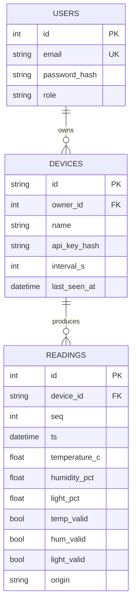

# Entity-relationship diagram

`UNIQUE (device_id, seq)` is what makes the ingestion idempotent: the same message sent twice leaves one row.
Sample queries for the live SQL step of the traceability demo are in `database/queries.sql`.
